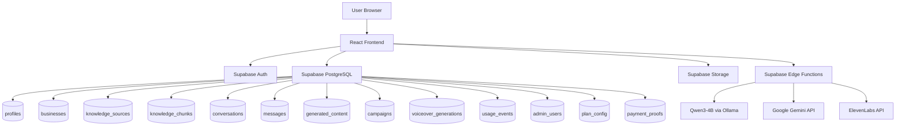
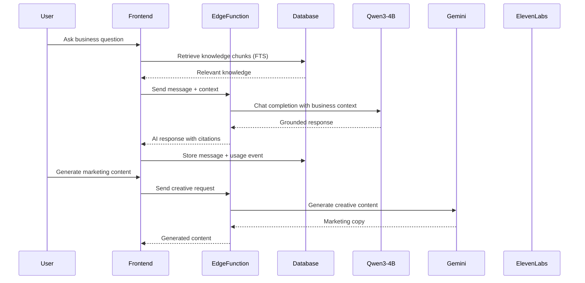

# BizAgent OS — Your Business. Your AI Team.

An AI-powered, multi-tenant SaaS platform that allows any business to register, upload business knowledge, and automatically create a personalized AI business agent powered by Qwen3-4B, Google Gemini, and ElevenLabs.

## Project Overview

BizAgent OS transforms business knowledge into a personalized AI-powered team. Businesses register, upload documents or add website URLs, and receive a dedicated AI agent that can answer questions, generate marketing content, create ad creatives, plan event campaigns, and produce AI voiceovers — all grounded in the business's own data.

## Problem Statement

Small and medium businesses lack the resources to maintain dedicated teams for customer support, marketing, advertising, and content creation. Hiring professionals for each function is expensive and time-consuming. Most AI tools are generic and don't understand the specific business context.

## Solution

BizAgent OS provides:
- A personalized AI agent that understands each business's products, services, and brand identity
- Knowledge-grounded responses using Qwen3-4B (open-weight model)
- Creative content generation using Google Gemini
- AI voiceover production using ElevenLabs
- A complete SaaS platform with subscription management and admin controls

## Original Technical Contribution

### Business Context Orchestrator
An original workflow that:
1. Receives business-specific user requests
2. Verifies workspace access
3. Identifies intent using Qwen3-4B
4. Retrieves relevant business knowledge via PostgreSQL full-text search
5. Uses Qwen3-4B to reason over the business context
6. Validates facts against available knowledge
7. Routes to appropriate tools (chat, marketing, ad creative, event, voiceover)
8. Returns results with source citations

### Multi-Tenant Knowledge Isolation
- Business-level data isolation through Supabase Row-Level Security (RLS)
- Business membership checks on every data operation
- Per-business knowledge chunks with tsvector full-text search indexing

### Admin Payment Approval System
- Custom admin panel at `/sadmin` for payment screenshot approval
- Plan configuration management (edit pricing, features, limits)
- Business account management and oversight

## Open-Weight Model Details

- **Model Name:** Qwen3-4B
- **Parameter Count:** 4 billion
- **Runtime/Provider:** Ollama (local) or any OpenAI-compatible inference endpoint
- **Model Identifier:** `qwen3:4b`
- **Integration:** Called via OpenAI-compatible `/v1/chat/completions` API from Supabase Edge Functions
- **Configuration:** `OPEN_MODEL_BASE_URL`, `OPEN_MODEL_NAME`, `OPEN_MODEL_API_KEY` environment variables

## AI Architecture

```
User Request → Edge Function → Business Context Builder
                                  ↓
                    Knowledge Retrieval (PostgreSQL FTS)
                                  ↓
                    Qwen3-4B (Intent + Reasoning)
                                  ↓
                    ┌─────────────┬──────────────┐
                    ↓             ↓              ↓
              Chat Response   Gemini        ElevenLabs
              (Qwen3-4B)    (Creative)     (Voiceover)
```

### Three AI Services:
1. **Qwen3-4B** — Core intelligence: business knowledge analysis, intent classification, grounded Q&A
2. **Google Gemini** — Creative intelligence: marketing copy, ad creatives, event campaigns, voiceover scripts
3. **ElevenLabs** — Voice intelligence: text-to-speech for marketing and event narration

## Installation Instructions

### Prerequisites
- Node.js 18+
- npm or yarn

### Frontend Setup
```bash
git clone https://github.com/yourusername/bizagent-os.git
cd bizagent-os
npm install
npm run dev
```

### Backend Setup
The project uses Supabase for:
- PostgreSQL database
- Authentication
- Storage
- Edge Functions (serverless AI orchestration)

Database migrations are applied via Supabase MCP tools. Edge functions are deployed via:
```bash
# Functions are in supabase/functions/
# Deploy through Supabase dashboard or MCP tools
```

## Environment Variables

```env
# Supabase (pre-populated)
SUPABASE_URL=your_supabase_url
SUPABASE_ANON_KEY=your_anon_key
SUPABASE_SERVICE_ROLE_KEY=your_service_role_key
VITE_SUPABASE_URL=your_supabase_url
VITE_SUPABASE_ANON_KEY=your_anon_key

# Qwen3-4B (Open-Weight Model)
OPEN_MODEL_BASE_URL=http://localhost:11434
OPEN_MODEL_NAME=qwen3:4b
OPEN_MODEL_API_KEY=

# Google Gemini
GEMINI_API_KEY=your_gemini_api_key

# ElevenLabs
ELEVENLABS_API_KEY=your_elevenlabs_api_key
```

## Architecture Diagram



## Data Flow Diagram



## Features

- User authentication (email/password)
- Business onboarding (4-step wizard)
- Knowledge base (file upload, URL extraction, manual text)
- AI chat with knowledge-grounded responses
- Marketing content studio (6 platforms)
- Ad creative studio
- Event marketing studio
- Voiceover studio (ElevenLabs)
- Campaign history
- Subscription management with payment proof upload
- Admin panel (`/sadmin`) for payment approvals, pricing management, and business oversight
- Three subscription tiers (Free, Pro, Business)

## Admin Panel

Access the admin panel at `/sadmin`:
- **Email:** owner@haqgroup.site
- **Password:** HASHIR54321@m

Admin capabilities:
- Approve/reject payment submissions
- Edit pricing plans (name, price, features, limits)
- View all registered businesses
- View platform statistics

## Test Cases and Results

| Test | Description | Result |
|------|-------------|--------|
| User Registration | Sign up with email/password | ✅ Pass — Account created, profile auto-generated |
| Business Onboarding | 4-step onboarding wizard | ✅ Pass — Business, subscription, agent created |
| Knowledge Upload | Upload text/URL knowledge | ✅ Pass — Text extracted, chunked, indexed |
| AI Chat | Ask business question | ✅ Pass — Qwen3-4B responds with knowledge context |
| Marketing Generation | Generate Instagram post | ✅ Pass — Gemini generates platform-appropriate content |
| Admin Login | Login at /sadmin | ✅ Pass — Admin authenticated via edge function |
| Payment Proof | Upload screenshot | ✅ Pass — Stored in Supabase Storage, record created |
| Admin Approval | Approve payment | ✅ Pass — Subscription activated |
| Plan Editing | Edit pricing in admin | ✅ Pass — Plan config updated |
| RLS Isolation | Cross-business access | ✅ Pass — RLS blocks unauthorized access |

## Known Limitations

1. **PDF/DOCX text extraction:** Currently only TXT, MD, and JSON files are fully extracted. PDF/DOCX show a placeholder.
2. **Voiceover:** Requires ElevenLabs API key to be configured in Supabase secrets.
3. **Gemini:** Requires GEMINI_API_KEY. Falls back to Qwen3-4B if unavailable.
4. **Qwen3-4B:** Requires Ollama running locally or a compatible hosted endpoint.
5. **Payments:** Demo mode — no real payment gateway. Users upload screenshots for manual admin approval.
6. **pgvector:** Uses PostgreSQL full-text search instead of vector similarity for the MVP.

## Tech Stack

- **Frontend:** React 18, TypeScript, Tailwind CSS, Lucide Icons, Framer Motion
- **Backend:** Supabase (PostgreSQL, Auth, Storage, Edge Functions)
- **AI Models:** Qwen3-4B (Ollama), Google Gemini, ElevenLabs
- **Build Tool:** Vite

## License

MIT License — see LICENSE file for details.

## Acknowledgements

- [Qwen3-4B](https://huggingface.co/Qwen/Qwen3-4B) — Open-weight language model by Alibaba Cloud
- [Google Gemini](https://ai.google.dev/) — Generative AI by Google
- [ElevenLabs](https://elevenlabs.io/) — AI text-to-speech
- [Supabase](https://supabase.com/) — Open-source Firebase alternative
- [Tailwind CSS](https://tailwindcss.com/) — Utility-first CSS framework
- [Lucide](https://lucide.dev/) — Icon library

Built for Hacktoberfest Islamabad 2026 Open AI Build Challenge.
